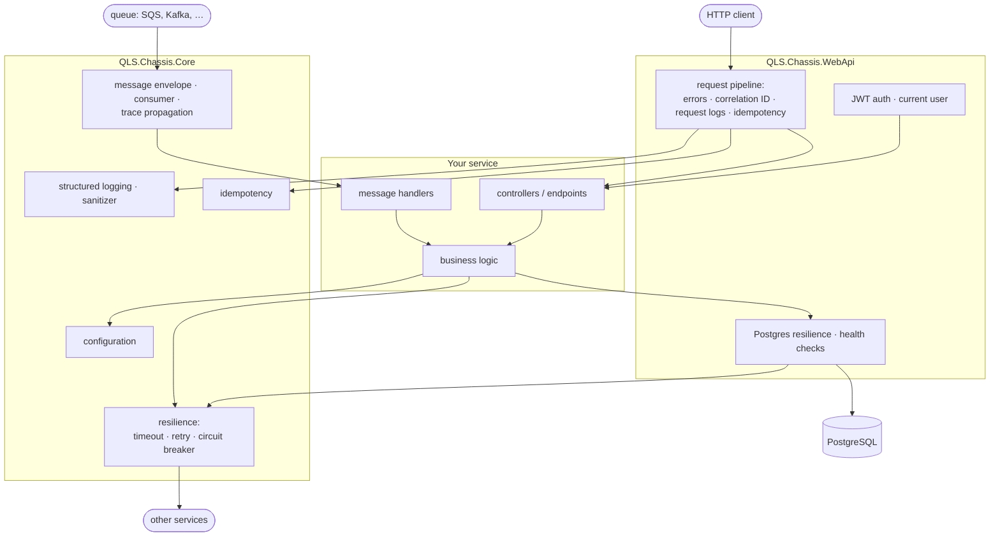

# dotnet-service-chassis

Reusable building blocks for .NET 8 services and ASP.NET Core APIs: the plumbing every service needs, written once.

A *service chassis* is the shared foundation under each microservice: how it reads configuration, calls a
dependency that might be down, makes a request or a message safe to process twice, handles errors, and logs so that
one request can be followed across services. With the chassis in place, each service only adds its own business
logic.

## What's inside

Two libraries, each usable on its own:

| Library | What it gives you | Guide |
| --- | --- | --- |
| **QLS.Chassis.Core** | Configuration reading, resilience (timeouts, retries with backoff, circuit breaker), HTTP and message idempotency, structured JSON logging with secret redaction, and a message envelope with validation, batch consumption and trace propagation. No ASP.NET Core dependency: works in APIs, workers, Lambda functions and console apps. | [docs/core.md](docs/core.md) |
| **QLS.Chassis.WebApi** | The ASP.NET Core layer: global error handling with problem details, correlation IDs, structured request logs, JWT authentication (with AWS Cognito support), current-user services, resilient Postgres access, idempotent endpoints, health checks and Swagger security. Builds on Core. | [docs/web-api.md](docs/web-api.md) |

### How the pieces fit



### Every component, with its guide and sample

| Component | What it's for | Guide | Sample |
| --- | --- | --- | --- |
| Configuration | Typed settings with defaults, and clear errors for missing keys | [Core: Configuration](docs/core.md#configuration) | [ConfigurationDemo.cs](samples/QLS.Chassis.Core.Sample/Demos/ConfigurationDemo.cs) |
| Resilience | Calling a dependency that might be slow or down without taking your service down with it | [Core: Resilience](docs/core.md#resilience) | [ResilienceDemo.cs](samples/QLS.Chassis.Core.Sample/Demos/ResilienceDemo.cs) |
| Idempotency | Making a retried request or redelivered message safe to process twice | [Core: Idempotency](docs/core.md#idempotency) | [MessagingDemo.cs](samples/QLS.Chassis.Core.Sample/Demos/MessagingDemo.cs) |
| Structured logging | One JSON log shape across services, with secrets redacted | [Core: Structured logging](docs/core.md#structured-logging) | [LoggingDemo.cs](samples/QLS.Chassis.Core.Sample/Demos/LoggingDemo.cs) |
| Message envelopes | Correlation and causation IDs that let you trace a chain of messages | [Core: envelopes](docs/core.md#messaging-envelopes-and-headers) | [MessagingDemo.cs](samples/QLS.Chassis.Core.Sample/Demos/MessagingDemo.cs) |
| Message consumption | Handling a batch where one bad message doesn't fail the rest | [Core: consuming](docs/core.md#messaging-consuming-messages) | [MessagingDemo.cs](samples/QLS.Chassis.Core.Sample/Demos/MessagingDemo.cs) |
| Trace propagation | Continuing a request's trace on the calls it makes | [Core: trace propagation](docs/core.md#messaging-trace-propagation) | [PropagationDemo.cs](samples/QLS.Chassis.Core.Sample/Demos/PropagationDemo.cs) |
| Request pipeline | Wiring errors, correlation, logging and idempotency in one call | [WebApi: pipeline](docs/web-api.md#the-request-pipeline) | [Program.cs](samples/QLS.Chassis.WebApi.Sample/Program.cs) |
| Error handling | Exceptions become consistent problem details responses | [WebApi: errors](docs/web-api.md#error-handling) | [OrderEndpoints.cs](samples/QLS.Chassis.WebApi.Sample/Orders/OrderEndpoints.cs) |
| Correlation IDs | One ID that follows a request through every log and service | [WebApi: correlation IDs](docs/web-api.md#correlation-ids) | [web API sample](#run-the-samples) |
| Request logging | A structured log line per request; failed ones with the sanitized request | [WebApi: logging](docs/web-api.md#request-logging-and-observability) | [web API sample](#run-the-samples) |
| JWT authentication | Bearer tokens from any OpenID Connect issuer, auth required by default | [WebApi: JWT](docs/web-api.md#jwt-authentication) | needs a token issuer; see the guide |
| Current user | The signed-in user's ID, name, email and phone | [WebApi: current user](docs/web-api.md#the-current-user) | needs a token issuer; see the guide |
| Postgres resilience | Database calls with timeouts, retries and a circuit breaker, plus a readiness check | [WebApi: Postgres](docs/web-api.md#postgres-resilience) | [OrderStores.cs](samples/QLS.Chassis.WebApi.Sample/Orders/OrderStores.cs) |
| HTTP idempotency | `[HttpIdempotent]` endpoints that replay the first response to a retry | [WebApi: idempotency](docs/web-api.md#http-idempotency) | [OrderEndpoints.cs](samples/QLS.Chassis.WebApi.Sample/Orders/OrderEndpoints.cs) |
| Health endpoints | Liveness and readiness probes | [WebApi: health](docs/web-api.md#health-endpoints) | [Program.cs](samples/QLS.Chassis.WebApi.Sample/Program.cs) |
| Swagger | API docs with a Bearer token button on secured endpoints | [WebApi: Swagger](docs/web-api.md#swagger) | [Program.cs](samples/QLS.Chassis.WebApi.Sample/Program.cs) |

A taste of an API on the chassis:

```csharp
var builder = WebApplication.CreateBuilder(args);

builder.Services.AddControllers();
builder.Services.AddChassisWebApi();                                    // errors, logging, current user
builder.Services.AddChassisJwtAuthentication(builder.Configuration);    // JWT bearer, auth required by default
builder.Services.AddChassisPostgresDatabaseResiliency(
    builder.Configuration, "AppDb", DatabaseResiliencePolicies.Default); // timeouts, retries, circuit breaker
builder.Services.AddChassisHttpIdempotency(
    HttpIdempotencyPolicies.Default, HttpIdempotencyCleanupPolicies.Default);

var app = builder.Build();

app.UseAuthentication();
app.UseChassisWebApi();    // exception handler, correlation ID, request logging, idempotency
app.UseAuthorization();

app.MapControllers();
app.MapChassisHealthEndpoints();
app.Run();
```

```csharp
[HttpPost]
[HttpIdempotent]   // a retried request with the same Idempotency-Key gets the stored response
public async Task<IActionResult> Create(CreateOrderRequest request, CancellationToken ct) { … }
```

## Requirements

- [.NET 8 SDK](https://dotnet.microsoft.com/download/dotnet/8.0) or later
- For the optional parts of QLS.Chassis.WebApi: PostgreSQL (database resilience, idempotency) and an OpenID Connect
  token issuer (JWT authentication). The samples run without either; Docker runs the optional Postgres mode.

## Getting started

```bash
git clone https://github.com/jmcfadden27/dotnet-service-chassis.git
cd dotnet-service-chassis
dotnet build
dotnet test
```

## Run the samples

### Core: a console tour

[samples/QLS.Chassis.Core.Sample](samples/QLS.Chassis.Core.Sample/Program.cs) runs one short demo per component,
each in its own file under [Demos/](samples/QLS.Chassis.Core.Sample/Demos):

```bash
dotnet run --project samples/QLS.Chassis.Core.Sample
```

```text
=== Configuration ===
Orders:MaxItems = 50 (from appsettings.json)
SAMPLE_REGION = eu-west-1 (from the environment)
Orders:MaxItems = 50 (appsettings.json still wins over the environment's 99)
Missing required key 'Orders:QueueUrl': Missing required configuration key 'Orders:QueueUrl'.

=== Structured logging ===
Failure event: operation_failed, category 'conflict' (from status 409)
Sanitized headers: {"Content-Type":"application/json","Authorization":"[REDACTED]","X-Api-Key":"[REDACTED]"}
Sanitized body:    {"email":"a@example.com","password":"[REDACTED]","profile":{"name":"Ada","secretCode":"[REDACTED]"}}

=== Messaging ===
Published order.created with message ID 6ccb3b71…
Derived invoice.requested: correlation corr-sample-1, caused by 6ccb3b71…
Handling order o-1 for $42.50
Handler ran 1 time(s) for 2 deliveries; failed transport IDs: sqs-3

=== Resilience ===
inventory-api answered 17 after 2 attempts
Gave up on payments-api: DependencyUnavailable, retry after 30s
Gave up on payments-api: CircuitOpen, retry after 30s

=== Trace propagation ===
X-Correlation-Id: corr-sample-1
X-Amzn-Trace-Id: Root=1-4bf92f35-77b34da6a3ce929d0e0e4736;Parent=00f067aa0ba902b7;Sampled=1
traceparent: 00-4bf92f3577b34da6a3ce929d0e0e4736-00f067aa0ba902b7-01
```

(Shortened: the real output also shows each structured log line.)

### Web API: an orders API

[samples/QLS.Chassis.WebApi.Sample](samples/QLS.Chassis.WebApi.Sample/Program.cs) runs two ways.

**Without a database** (error handling, correlation IDs, request logs, health endpoints, Swagger):

```bash
dotnet run --project samples/QLS.Chassis.WebApi.Sample      # http://localhost:5080, Swagger at /swagger
```

```bash
curl -i http://localhost:5080/health/live
# 200 Healthy, with an X-Correlation-Id response header

curl -i -X POST http://localhost:5080/orders -H 'Content-Type: application/json' \
  -H 'X-Correlation-Id: demo-123' -d '{"sku":"ABC-1","quantity":2}'
# 201 Created; the response carries X-Correlation-Id: demo-123

curl -s -X POST http://localhost:5080/orders -H 'Content-Type: application/json' -d '{"sku":"ABC-1","quantity":0}'
# {"title":"Invalid order","status":400,"detail":"Quantity must be at least 1.","instance":"/orders","traceId":"…"}

curl -s http://localhost:5080/orders/nope
# {"title":"Resource not found","status":404,"detail":"Order 'nope' was not found.","instance":"/orders/nope",…}
```

**With Postgres** (adds Postgres resilience, the database readiness check and an idempotent `POST /orders`).
[docker-compose.yml](samples/QLS.Chassis.WebApi.Sample/docker-compose.yml) starts a local database and creates its
tables from [db/init.sql](samples/QLS.Chassis.WebApi.Sample/db/init.sql):

```bash
docker compose -f samples/QLS.Chassis.WebApi.Sample/docker-compose.yml up -d
dotnet run --project samples/QLS.Chassis.WebApi.Sample --launch-profile postgres
```

```bash
curl -s -X POST http://localhost:5080/orders -H 'Content-Type: application/json' \
  -H 'Idempotency-Key: k-1' -d '{"sku":"XYZ-9","quantity":1}'
# 201 {"id":"f49bcfa4","sku":"XYZ-9","quantity":1}

# The same request again, as a client would retry after a timeout: the stored 201 comes back; no second order
curl -s -X POST http://localhost:5080/orders -H 'Content-Type: application/json' \
  -H 'Idempotency-Key: k-1' -d '{"sku":"XYZ-9","quantity":1}'
# 201 {"id":"f49bcfa4","sku":"XYZ-9","quantity":1}

# The same key with a different body
curl -s -X POST http://localhost:5080/orders -H 'Content-Type: application/json' \
  -H 'Idempotency-Key: k-1' -d '{"sku":"XYZ-9","quantity":5}'
# 409 {"title":"Idempotency key conflict",…}
```

To see the circuit breaker, stop the database while the API runs
(`docker compose -f samples/QLS.Chassis.WebApi.Sample/docker-compose.yml stop`) and call `GET /orders/x` a few times:
the first requests fail with 500 after their retries, then 503 in milliseconds once the circuit opens. When you're
done, remove the database with `docker compose -f samples/QLS.Chassis.WebApi.Sample/docker-compose.yml down -v`.

Every request writes one structured JSON log line (`request_succeeded`, or `request_failed` with the sanitized
request) to the console.

## Using it in your project

Reference the project you need. QLS.Chassis.WebApi brings QLS.Chassis.Core with it.

```xml
<ItemGroup>
  <ProjectReference Include="path/to/dotnet-service-chassis/src/QLS.Chassis.WebApi/QLS.Chassis.WebApi.csproj" />
</ItemGroup>
```

Or build NuGet packages and use them from a local or private feed. Each library project has its package details
(description, license, repository and readme):

```bash
dotnet pack src/QLS.Chassis.Core -c Release -o ./artifacts
dotnet pack src/QLS.Chassis.WebApi -c Release -o ./artifacts
dotnet nuget add source "$(pwd)/artifacts" --name chassis-local
dotnet add path/to/YourApi package QLS.Chassis.WebApi --version 0.1.0
```

The guides show how to register and use each component:

- [docs/core.md](docs/core.md): configuration, resilience, idempotency, structured logging, messaging, with
  walkthroughs for publishing events, consuming SQS batches in Lambda, and safe HTTP calls.
- [docs/web-api.md](docs/web-api.md): the request pipeline, error handling, authentication, Postgres resilience,
  idempotent endpoints, health checks and Swagger, with walkthroughs from a new API to idempotent endpoints.

## Repository layout

```text
dotnet-service-chassis/
├── src/
│   ├── QLS.Chassis.Core/            the core library
│   └── QLS.Chassis.WebApi/          the ASP.NET Core library
├── tests/
│   ├── QLS.Chassis.Core.Tests/      xUnit tests for Core
│   └── QLS.Chassis.WebApi.Tests/    xUnit tests for WebApi (no database or issuer needed)
├── samples/
│   ├── QLS.Chassis.Core.Sample/     console tour of Core, one demo per component
│   └── QLS.Chassis.WebApi.Sample/   orders API on the chassis (optional Postgres mode)
├── docs/                            component guides
├── QLS.Chassis.sln
├── Directory.Build.props            version and package details shared by all projects
└── global.json                      .NET SDK version (8.0 or later)
```

## Tests

```bash
dotnet test
```

The tests (xUnit, Moq and the ASP.NET Core test host) cover every component and double as usage examples.

## Versioning

The libraries follow [semantic versioning](https://semver.org); the version is set in `Directory.Build.props`.
Changes are listed in [CHANGELOG.md](CHANGELOG.md).

## Contributing and security

See [CONTRIBUTING.md](CONTRIBUTING.md). To report a security issue, see [SECURITY.md](SECURITY.md).

## Disclaimer

This code is shared as a reference for others to learn from and reuse. You're free to use, copy and change it under
the [MIT license](LICENSE), at your own risk.

It is provided **"as is", without warranty of any kind**, express or implied, including fitness for a particular
purpose. The author is not liable for any claim, damages or other liability arising from its use, including in
production systems. Review, test and secure it for your own needs before relying on it. The [LICENSE](LICENSE) file
contains the full, binding terms.

## License

[MIT](LICENSE) © Jim McFadden
