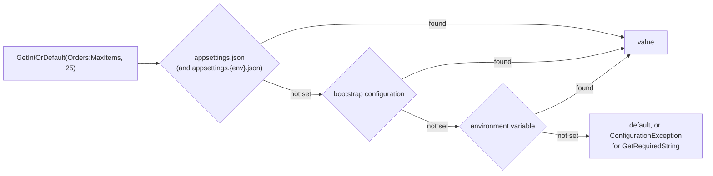
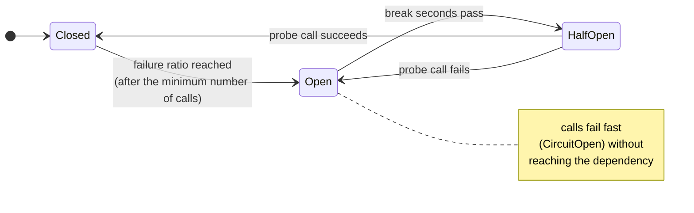
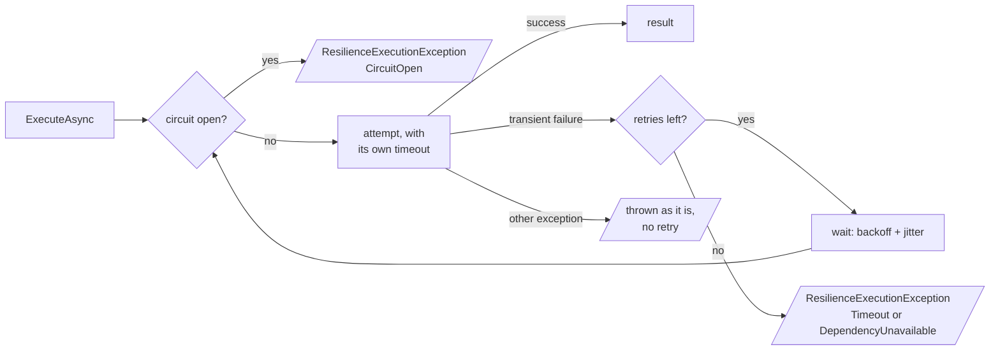
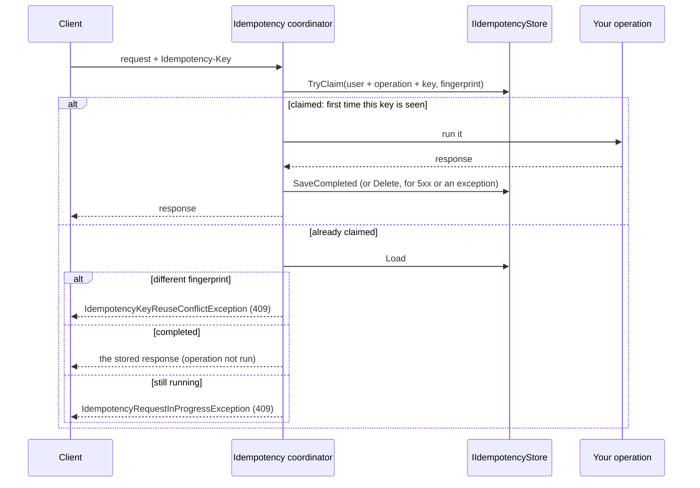
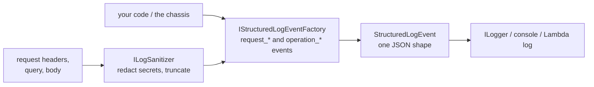
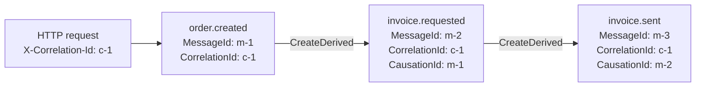

# QLS.Chassis.Core

Shared building blocks for .NET services: configuration reading, resilience (timeouts, retries and a circuit
breaker), idempotency, structured logging, and a message envelope with validation, consumption and trace propagation.

A *chassis* is the plumbing every service needs but nobody wants to rewrite: how to read settings, how to call a
dependency that might be down, how to make a request or a message safe to process twice, and how to log so that one
request can be followed across services. This library holds those pieces once, so each service only adds its own
business logic.

It has no dependency on ASP.NET Core. The web layer (middleware, JWT auth, Postgres-backed idempotency, health checks)
is [QLS.Chassis.WebApi](web-api.md), which builds on this library. Setup, the samples and the repository layout are
in the [README](../README.md).

## Contents

- [Dependencies](#dependencies)
- [Components](#components)
  - [Configuration](#configuration)
  - [Resilience](#resilience)
  - [Idempotency](#idempotency)
  - [Structured logging](#structured-logging)
  - [Messaging: envelopes and headers](#messaging-envelopes-and-headers)
  - [Messaging: consuming messages](#messaging-consuming-messages)
  - [Messaging: trace propagation](#messaging-trace-propagation)
- [Walkthroughs](#walkthroughs)
  - [1. Publish an event](#1-publish-an-event)
  - [2. Consume a batch of messages from SQS in AWS Lambda](#2-consume-a-batch-of-messages-from-sqs-in-aws-lambda)
  - [3. Call an external HTTP API safely](#3-call-an-external-http-api-safely)
  - [4. Read configuration with defaults](#4-read-configuration-with-defaults)

## Dependencies

Core needs no other services. Some components are designed around AWS conventions (SQS, X-Ray trace headers), but
nothing in this library calls AWS. Its packages are the `Microsoft.Extensions` configuration, dependency injection
and logging abstractions, and Newtonsoft.Json.

**Why two JSON libraries.** Core uses each where it fits:

- **Newtonsoft.Json** reads message envelopes (`MessageEnvelopeProcessor`), stores and reads idempotency responses,
  powers the log sanitizer, and writes the message consumption log lines. Its default deserialization matches
  property names without regard to case, so an envelope parses whether its producer wrote `correlationId` or
  `CorrelationId`, and its `JToken` tree lets the sanitizer redact a field at any depth of a JSON body without knowing
  the body's shape.
- **System.Text.Json** writes the resilience log lines (and the request and app log lines in QLS.Chassis.WebApi). It is
  built into .NET, so it adds no dependency.

Both write the same property names (`CorrelationId`, `EventName` and so on), so a log event looks the same whichever
library wrote it.

## Components

| Component | Namespace | What it gives you |
| --- | --- | --- |
| [Configuration](#configuration) | `QLS.Chassis.Core.Configuration` | Typed reads of settings from `appsettings.json`, a bootstrap source and environment variables, with clear errors |
| [Resilience](#resilience) | `QLS.Chassis.Core.Resilience` | Per-attempt timeouts, retries with exponential backoff and jitter, and a circuit breaker per dependency |
| [Idempotency](#idempotency) | `QLS.Chassis.Core.Idempotency` | Process an HTTP request or a message once; repeats get the stored response |
| [Structured logging](#structured-logging) | `QLS.Chassis.Core.Logging` | One JSON log event shape for every service, error categories, and a sanitizer that redacts secrets |
| [Messaging](#messaging-envelopes-and-headers) | `QLS.Chassis.Core.Messaging.*` | A message envelope with correlation and causation IDs, validation, a batch consumer, and trace header propagation |

### Configuration

> **See it run:** [../samples/QLS.Chassis.Core.Sample/Demos/ConfigurationDemo.cs](../samples/QLS.Chassis.Core.Sample/Demos/ConfigurationDemo.cs)



`ConfigReader` reads a key from three places, in this order, and uses the first non-blank value it finds:

1. `appsettings.json`, then `appsettings.{environment}.json` (environment from `DOTNET_ENVIRONMENT`, else
   `ASPNETCORE_ENVIRONMENT`, else `Production`), read from the application's base directory.
2. A *bootstrap* configuration you pass in: for example values loaded from a secrets store at start-up.
3. Environment variables.

> **Note the order:** a value in `appsettings.json` wins over an environment variable with the same name. That is the
> reverse of the usual ASP.NET Core convention, and deliberate here: `appsettings.json` holds the service's own
> settings and environment variables fill in what it leaves out. If you want environment variables to override, use
> `ConfigurationSources.MappingConfiguration` (below) instead.

| Method | Missing key | Value can't be parsed |
| --- | --- | --- |
| `GetRequiredString(key)` | throws `ConfigurationException` | — |
| `GetStringOrDefault(key, default)` | returns `default` | — |
| `GetIntOrDefault` / `GetLongOrDefault` / `GetBoolOrDefault` | returns `default` | throws `ConfigurationException` |
| `GetCsvSetOrDefault(key, defaults, comparer?)` | returns a set of `defaults` | — (splits on commas, trims, drops blanks; case-insensitive unless you pass a comparer) |

`ConfigurationException.Key` tells you which key failed, so start-up errors name the setting to fix.

`ConfigurationSourcesBuilder.Build(bootstrap?)` returns a `ConfigurationSources` with three views:

- `AppSettingsConfiguration`: only the JSON files.
- `BootstrapConfiguration`: what you passed in (or `null`).
- `MappingConfiguration`: all three layered the usual way (JSON, then bootstrap, then environment variables, later
  ones winning), for binding option classes.

Registering it:

```csharp
using QLS.Chassis.Core.Configuration;

builder.Services.AddSingleton(ConfigurationSourcesBuilder.Build());
builder.Services.AddSingleton<IEnvironmentProvider, EnvironmentProvider>();
builder.Services.AddSingleton<IConfigReader, ConfigReader>();
```

`IEnvironmentProvider` exists so tests can supply environment variables without touching the real process
environment.

### Resilience

> **See it run:** [../samples/QLS.Chassis.Core.Sample/Demos/ResilienceDemo.cs](../samples/QLS.Chassis.Core.Sample/Demos/ResilienceDemo.cs) (a retry that recovers, then a
> dependency that stays down until its circuit opens), and
> [../samples/QLS.Chassis.WebApi.Sample/Orders/OrderStores.cs](../samples/QLS.Chassis.WebApi.Sample/Orders/OrderStores.cs) (every Postgres query through it).

`ResilienceExecutor` runs an operation against a named dependency with three protections:

1. **A timeout per attempt** (`TimeoutMs`). The operation gets a `CancellationToken` that is cancelled when the
   attempt runs out of time, or when the caller's token is cancelled.
2. **Retries for transient failures** (`MaxRetries`, so `1 + MaxRetries` attempts in all), waiting
   `BaseDelayMs × 2^attempt` plus random jitter (up to half of `BaseDelayMs`) between attempts, capped at 5 seconds.
3. **A circuit breaker per dependency name.** Once at least `CircuitMinThroughput` calls have been sampled and the
   failure ratio reaches `CircuitFailureRatio`, the circuit *opens*: for `CircuitBreakSeconds`, calls fail
   immediately without reaching the dependency. After that, one *half-open* probe call is let through: success
   closes the circuit, failure opens it again.



One call, from the caller's side:



**What counts as transient:** a timeout, `HttpRequestException`, `TaskCanceledException`, and anything your
`TransientExceptionClassifier` returns `true` for. Any other exception (a validation error, a 404 you turned into an
exception) is thrown to you straight away without a retry, and counts as a *success* for the circuit: the dependency
answered, so it isn't down.

**When it gives up**, it throws `ResilienceExecutionException` with:

| Property | Meaning |
| --- | --- |
| `DependencyName` | which dependency failed |
| `FailureType` | `Timeout`, `DependencyUnavailable` (transient failures exhausted the retries) or `CircuitOpen` (failed fast) |
| `RetryAfterSeconds` | a suggested wait before trying again, for a `Retry-After` header |
| `InnerException` | the last underlying failure (not set for `CircuitOpen`) |

**Defaults** (`ResilienceDefaults.For("name")`, from `ResilienceDefaultsProfile`):

| Setting | Default | Meaning |
| --- | --- | --- |
| `TimeoutMs` | 2500 | per-attempt timeout |
| `MaxRetries` | 2 | retries after the first attempt |
| `BaseDelayMs` | 200 | backoff base |
| `CircuitFailureRatio` | 0.5 | failure ratio that opens the circuit |
| `CircuitMinThroughput` | 10 | calls sampled before the ratio counts |
| `CircuitBreakSeconds` | 30 | how long the circuit stays open |
| `RetryAfterSeconds` | 30 | suggested client wait |

To change the defaults everywhere, subclass `ResilienceDefaultsProfile` and assign it to `ResilienceDefaults.Profile`
at start-up. Out-of-range values are corrected rather than rejected (for example a ratio of 0 or below becomes 0.1).

Each resilience event (`retry`, `timeout`, `dependency_failure`, `circuit_opened`, `circuit_open`, `circuit_closed`) is
logged through `ILogger<ResilienceExecutor>` as one JSON [structured log event](#structured-logging), with the
dependency name, attempt number and the correlation ID from `ICorrelationIdAccessor`. Failures (`timeout`,
`dependency_failure`, `circuit_opened`, `circuit_open`) are logged at Warning, the rest at Information. The event's
`Service` is `ResilienceLoggingOptions.ServiceName`, or the entry assembly's name when that isn't set; QLS.Chassis.WebApi
sets it to the app's name.

Registering it (the executor is a singleton because it holds the circuit state):

```csharp
using QLS.Chassis.Core.Resilience;

builder.Services.AddLogging(); // already registered in ASP.NET Core and generic-host apps
builder.Services.AddSingleton<ICorrelationIdAccessor, MyCorrelationIdAccessor>(); // QLS.Chassis.WebApi provides one for HTTP
builder.Services.AddSingleton(new ResilienceLoggingOptions { ServiceName = "order-service" }); // optional
builder.Services.AddSingleton<IResilienceExecutor, ResilienceExecutor>();
```

Using it:

```csharp
var options = ResilienceDefaults.For("payments-api");

var receipt = await resilience.ExecuteAsync(options, async ct =>
{
    using var response = await httpClient.PostAsJsonAsync("charges", charge, ct);
    response.EnsureSuccessStatusCode();
    return await response.Content.ReadFromJsonAsync<Receipt>(cancellationToken: ct);
}, cancellationToken);
```

Calls that use the same `DependencyName` share one circuit, so name dependencies, not call sites.

### Idempotency

> **See it run:** message idempotency in [../samples/QLS.Chassis.Core.Sample/Demos/MessagingDemo.cs](../samples/QLS.Chassis.Core.Sample/Demos/MessagingDemo.cs) (the same
> message delivered twice is handled once), and HTTP idempotency in the [web API sample's](../README.md#run-the-samples)
> `POST /orders` ([../samples/QLS.Chassis.WebApi.Sample/Orders/OrderEndpoints.cs](../samples/QLS.Chassis.WebApi.Sample/Orders/OrderEndpoints.cs)).



Idempotency makes it safe to send the same request or message more than once: the first one runs, and repeats get
the stored result instead of running again. There are two coordinators: one for HTTP requests and one for messages.

**How a call goes through `HttpIdempotencyCoordinator`:**

1. If the policy doesn't require idempotency for the HTTP method, the operation just runs. The default policy covers
   `POST`, `PUT`, `PATCH` and `DELETE`.
2. It reads the key from the `Idempotency-Key` header. A missing key, or one longer than 128 characters, throws
   `IdempotencyKeyRequiredException`.
3. It builds a **record key** from the user, the operation name and a SHA-256 hash of the idempotency key, so keys
   never clash between users or operations, and a **fingerprint**: a SHA-256 hash of the operation, method, path,
   sorted query string and body.
4. It asks the store to **claim** the record. If the claim succeeds, the operation runs:
   - a response the policy wants kept (by default anything below 500) is saved with the fingerprint, for the
     record's lifetime (24 hours by default);
   - any other response, or an exception, deletes the claim, so the client can safely retry.
5. If the claim fails, a record already exists:
   - a **different fingerprint** means the key was reused for a different request: `IdempotencyKeyReuseConflictException`;
   - a **completed** record returns the stored response;
   - otherwise the first request is still running: `IdempotencyRequestInProgressException`.

`MessageIdempotencyCoordinator` works the same way for messages, keyed by consumer name, operation name and the
message's idempotency key, and fingerprinted on those plus the message body. It applies to every message: there is no
method check.

**The store** is yours to provide ([QLS.Chassis.WebApi](web-api.md#http-idempotency) has a Postgres one). `IIdempotencyStore` has four methods:

| Method | Must |
| --- | --- |
| `TryClaimAsync(key, fingerprint, expiresAt, now)` | atomically create an in-progress record, or replace one that has expired; return `true` only if this call claimed it |
| `LoadAsync(key)` | return the record (`Status`, `Fingerprint`, `ResponseJson`), or `null` |
| `SaveCompletedAsync(key, fingerprint, response, expiresAt)` | mark the record `COMPLETED` and store the response as JSON |
| `DeleteAsync(key)` | remove the record |

Times are Unix epoch seconds. A minimal in-memory store, fine for tests or a single instance:

```csharp
using System.Collections.Concurrent;
using Newtonsoft.Json;
using QLS.Chassis.Core.Idempotency;

public sealed class InMemoryIdempotencyStore : IIdempotencyStore
{
    private sealed record Entry(string Status, string Fingerprint, string ResponseJson, long ExpiresAt);
    private readonly ConcurrentDictionary<string, Entry> _entries = new();

    public Task<bool> TryClaimAsync(string key, string fingerprint, long expiresAt, long now)
    {
        var claim = new Entry("IN_PROGRESS", fingerprint, string.Empty, expiresAt);
        while (true)
        {
            if (_entries.TryAdd(key, claim))
                return Task.FromResult(true);
            if (!_entries.TryGetValue(key, out var existing))
                continue;
            if (existing.ExpiresAt >= now)
                return Task.FromResult(false);
            if (_entries.TryUpdate(key, claim, existing))
                return Task.FromResult(true);
        }
    }

    public Task<IdempotencyStoreRecord?> LoadAsync(string key) =>
        Task.FromResult(_entries.TryGetValue(key, out var e)
            ? new IdempotencyStoreRecord { Status = e.Status, Fingerprint = e.Fingerprint, ResponseJson = e.ResponseJson }
            : null);

    public Task SaveCompletedAsync(string key, string fingerprint, HttpIdempotencyExecutionResponse response, long expiresAt)
    {
        _entries[key] = new Entry("COMPLETED", fingerprint, JsonConvert.SerializeObject(response), expiresAt);
        return Task.CompletedTask;
    }

    public Task DeleteAsync(string key)
    {
        _entries.TryRemove(key, out _);
        return Task.CompletedTask;
    }
}
```

Registering it:

```csharp
builder.Services.AddSingleton<IIdempotencyStore, InMemoryIdempotencyStore>();
builder.Services.AddSingleton<IHttpIdempotencyPolicy, DefaultHttpIdempotencyPolicy>();
builder.Services.AddSingleton<IHttpIdempotencyCoordinator, HttpIdempotencyCoordinator>();

builder.Services.AddSingleton<IMessageIdempotencyPolicy, DefaultMessageIdempotencyPolicy>();
builder.Services.AddSingleton<IMessageIdempotencyCoordinator, MessageIdempotencyCoordinator>();
```

To change the header name, the methods covered, how long records live or which responses are kept, implement
`IHttpIdempotencyPolicy` or `IMessageIdempotencyPolicy`.

### Structured logging

> **See it run:** [../samples/QLS.Chassis.Core.Sample/Demos/LoggingDemo.cs](../samples/QLS.Chassis.Core.Sample/Demos/LoggingDemo.cs) (a failure event and its error category,
> and a request with its secrets redacted). Every other demo's log lines are these events too.



Every chassis log line is one JSON object of the same shape, `StructuredLogEvent`, so logs from different services
can be searched and joined the same way:

```json
{
  "SchemaVersion": 1,
  "TimestampUtc": "2026-11-11T14:03:22.4810000Z",
  "Level": "Error",
  "EventName": "operation_failed",
  "Service": "order-service",
  "Operation": "orders.create",
  "CorrelationId": "6f1c…",
  "TraceId": "4bf92f3577b34da6a3ce929d0e0e4736",
  "RequestId": "req-1",
  "MessageId": null,
  "CausationId": null,
  "UserId": "user-1",
  "StatusCode": 409,
  "DurationMs": 42,
  "ErrorCategory": "conflict",
  "ErrorType": "InvalidOperationException",
  "ErrorMessage": "…",
  "ErrorStackTrace": "…",
  "Metadata": { "orderId": "o-1" }
}
```

`DefaultStructuredLogEventFactory` (`IStructuredLogEventFactory`) builds the five standard events:

| Method | `EventName` | Level |
| --- | --- | --- |
| `CreateRequestSucceeded` | `request_succeeded` | Information |
| `CreateRequestFailed` | `request_failed` | Error |
| `CreateOperationSucceeded` | `operation_succeeded` | Information |
| `CreateOperationFailed` | `operation_failed` | Error |
| `CreateOperationWarning` | `operation_warning` | Warning |

Failure events get an `ErrorCategory`, from the exception and the status code:

| Condition | `ErrorCategory` |
| --- | --- |
| exception type name contains "Idempotency" | `idempotency` |
| 401 / 403 / 404 / 409 / 429 | `authentication` / `authorization` / `not_found` / `conflict` / `rate_limited` |
| other 4xx | `validation` |
| 5xx | `dependency_failure` |
| anything else | `unexpected` |

Stack traces are cut at 16 KB.

**`DefaultLogSanitizer`** (`ILogSanitizer`) makes request data safe to log. It redacts any header, query parameter,
JSON property (at any depth) or form field whose name contains one of: `authorization`, `cookie`, `token`, `secret`,
`password`, `pwd`, `apikey`, `api_key`, `credential`, `session`, `jwt`. Names are compared without `-`, `_` and `.`,
so `X-Api-Key` and `api.key` both match. It also:

- cuts header and query values at 256 characters and bodies at 4 KB, and reports `Truncated`;
- leaves out binary bodies (`multipart/*`, images, video, audio, PDF, zip, octet-stream, base64) with a reason;
- keeps JSON and form bodies (redacted), and replaces any other body with `[NON_JSON_BODY_OMITTED]`;
- reports `RedactionApplied` when anything was redacted.

```csharp
var sanitized = sanitizer.Sanitize(new LogSanitizerRequest
{
    Headers = new Dictionary<string, string> { ["Content-Type"] = "application/json", ["Authorization"] = "Bearer …" },
    Body = "{\"name\":\"A\",\"password\":\"hunter2\"}",
});
// sanitized.Headers["Authorization"] == "[REDACTED]"
// sanitized.Body == "{\"name\":\"A\",\"password\":\"[REDACTED]\"}"
```

### Messaging: envelopes and headers

> **See it run:** [../samples/QLS.Chassis.Core.Sample/Demos/MessagingDemo.cs](../samples/QLS.Chassis.Core.Sample/Demos/MessagingDemo.cs) (a root message, and a derived one that
> points back at it).



Same `CorrelationId` all the way down; each `CausationId` names the message that caused it.

Every message travels in a `MessageEnvelope<T>`: a `Header` with the metadata needed to trace and de-duplicate it,
and your `Body`.

| Header field | Meaning |
| --- | --- |
| `SchemaVersion` | envelope version (the factory sets 1) |
| `OccurredUtc` | when the message was created, in UTC |
| `MessageId` | unique ID for this message (a new GUID) |
| `MessageType` | what happened, for example `order.created` |
| `Producer` | the service that sent it |
| `CorrelationId` | the ID shared by everything that one original request caused |
| `CausationId` | the `MessageId` of the message that caused this one (derived messages only) |
| `TraceId` / `SpanId` | distributed tracing IDs |

`MessageEnvelopeFactory` (`IMessageEnvelopeFactory`) creates them:

- `CreateRoot(body, messageType, producer, correlationId, traceId)`: a message that starts a chain, for example
  in response to an HTTP request.
- `CreateDerived(body, messageType, producer, correlationId, traceId, causationId)`: a message sent while handling
  another. Pass the incoming message's `MessageId` as `causationId`, and keep its `CorrelationId`.

Following `CorrelationId` gives you every message one request caused; following `CausationId` gives you the exact
chain.

`MessageHeaderValidator` checks a header before it is sent or after it is received: `SchemaVersion` above 0,
`OccurredUtc` set and in UTC, and `CorrelationId`, `MessageId`, `MessageType`, `Producer` and `TraceId` present.
Derived messages also need `CausationId`. Failures throw `MessageHeaderValidationException`.

`ValidatedMessageEnvelopeFactory` (`IValidatedMessageEnvelopeFactory`) is the factory plus the validator: use it to
publish, so an invalid message is never sent.

### Messaging: consuming messages

> **See it run:** [../samples/QLS.Chassis.Core.Sample/Demos/MessagingDemo.cs](../samples/QLS.Chassis.Core.Sample/Demos/MessagingDemo.cs) (a batch with a duplicate and a
> malformed message).

```mermaid
flowchart LR
    B["batch of transport records<br/>(SQS, Kafka, …)"] --> P["MessageEnvelopeProcessor<br/>parse + validate the header"]
    P -- invalid --> X["logged as failed,<br/>ID added to FailedMessageIds"]
    P -- valid --> Iidempotency<br/>coordinator?
    I -- "yes: seen before" --> S["skipped: already handled"]
    I -- "no / first time" --> Hd["your handler"]
    Hd -- throws --> X
    Hd -- ok --> OK["operation_succeeded logged"]
```

Each record is handled on its own, so one bad message never fails the rest of the batch.

The consumption pieces turn a batch of raw transport records (SQS messages, Kafka records, anything) into handled
messages, each one logged, and tell you which ones failed.

- **`MessageEnvelopeProcessor`** deserializes a raw body into `MessageEnvelope<T>`, checks the header, body and header
  fields (with `MessageHeaderValidator`), and returns the envelope plus a `MessageProcessingContext` (the header
  values and the transport's own message ID).
- **`MessageConsumerExecutor`** runs a batch. For each record it processes the envelope and calls your handler; with an
  `IMessageIdempotencyCoordinator`, the handler runs inside it, keyed by the envelope's `MessageId`, so a redelivered
  message isn't handled twice. A record that fails, whether it doesn't
  parse, fails validation or the handler throws, is logged and its transport ID is added to `FailedMessageIds`; the
  rest of the batch carries on.
- **`MessageConsumptionLogger`** writes an `operation_succeeded` or `operation_failed` [structured
  event](#structured-logging) per message, with the message's header values as metadata. Parse and validation errors,
  and any `InvalidOperationException` (including one your handler throws), are logged as 400; anything else as 500.
- **`IMessageExecutionContext`** is how the executor knows the service name, the request ID and where to write logs.
  `MessageExecutionContext` takes delegates, so it fits any host (a Lambda's logger, `ILogger`, the console).

Registering it:

```csharp
builder.Services.AddChassisCoreMessaging(); // factory and validator
builder.Services.AddSingleton<IStructuredLogEventFactory, DefaultStructuredLogEventFactory>();
builder.Services.AddSingleton<IMessageEnvelopeProcessor, MessageEnvelopeProcessor>();
builder.Services.AddSingleton<IMessageConsumptionLogger, MessageConsumptionLogger>();
builder.Services.AddSingleton<IMessageConsumerExecutor, MessageConsumerExecutor>();
```

If an `IMessageIdempotencyCoordinator` is registered, the executor uses it.

**SQS consumer settings.** `SqsConsumerPolicies.Default` holds suggested values for a long-polling SQS consumer you
write yourself: `MaxNumberOfMessages` 10, `WaitTimeSeconds` 20, `VisibilityTimeoutSeconds` 120, `ErrorDelaySeconds` 3
and `MessageAttributeNames` `["All"]`. Pass them to your `ReceiveMessage` call; this library doesn't call SQS itself.

### Messaging: trace propagation

> **See it run:** [../samples/QLS.Chassis.Core.Sample/Demos/PropagationDemo.cs](../samples/QLS.Chassis.Core.Sample/Demos/PropagationDemo.cs) (an inbound `traceparent`
> continued on an outgoing request, with the matching X-Ray header).

```mermaid
flowchart TD
    Aboth inbound headers? -- yes --> U[use them as they are]
    A -- no --> Binbound X-Ray only? -- yes --> BX[build traceparent from it]
    B -- no --> Cinbound traceparent only? -- yes --> CX[build X-Ray from it]
    C -- no --> D_X_AMZN_TRACE_ID set?<br/>(AWS Lambda) -- yes --> DX[build traceparent from it]
    D -- no --> E[derive a trace from the correlation ID]
```

`OutboundHeaderPropagator` adds tracing headers to an outgoing `HttpRequestMessage`, so the next service continues
the same trace:

| Header | Value |
| --- | --- |
| `X-Correlation-Id` | the current correlation ID (required: missing throws `OutboundHeaderPropagationException`) |
| `X-Amzn-Trace-Id` | AWS X-Ray trace header |
| `traceparent` | W3C trace context |

It picks the trace from the first of these it finds:

1. both inbound headers (from `ITraceHeaderAccessor`), used as they are;
2. only the inbound X-Ray header, with `traceparent` built from it;
3. only the inbound `traceparent`, with the X-Ray header built from it;
4. the `_X_AMZN_TRACE_ID` environment variable (set by AWS Lambda), with `traceparent` built from it;
5. otherwise a trace derived from the correlation ID, so calls in one request share a trace even without a tracer.

The X-Ray and W3C formats carry the same 128-bit trace ID, which is why one can be built from the other. Header names
are in `ChassisHeaderNames`.

Without an `ITraceHeaderAccessor`, `NullTraceHeaderAccessor` is used (no inbound headers).

## Walkthroughs

### 1. Publish an event

> Runnable version: [../samples/QLS.Chassis.Core.Sample/Demos/MessagingDemo.cs](../samples/QLS.Chassis.Core.Sample/Demos/MessagingDemo.cs).

A service creates an order and publishes `order.created`:

```csharp
public sealed class OrderService(IValidatedMessageEnvelopeFactory envelopes, IMessagePublisher publisher)
{
    public async Task CreateAsync(Order order, string correlationId, string traceId, CancellationToken ct)
    {
        // … save the order …

        var envelope = envelopes.CreateRoot(
            body: new OrderCreated(order.Id, order.Total),
            messageType: "order.created",
            producer: "order-service",
            correlationId: correlationId,
            traceId: traceId);

        await publisher.PublishAsync(JsonConvert.SerializeObject(envelope), ct); // your transport
    }
}

public sealed record OrderCreated(string OrderId, decimal Total);
```

A consumer that reacts by sending `invoice.requested` uses `CreateDerived`, passing the incoming envelope's
`Header.CorrelationId` and `Header.MessageId` (as `causationId`), so the invoice can be traced back to the order.

### 2. Consume a batch of messages from SQS in AWS Lambda

`FailedMessageIds` maps directly onto Lambda's *partial batch response*: only the failed messages go back to the
queue. (`SQSEvent`, `SQSBatchResponse` and `ILambdaContext` come from the `Amazon.Lambda.SQSEvents` and
`Amazon.Lambda.Core` packages; turn on `ReportBatchItemFailures` on the event source mapping.)

```csharp
public sealed class Function(IMessageConsumerExecutor executor, IInvoiceService invoices)
{
    public async Task<SQSBatchResponse> HandleAsync(SQSEvent sqsEvent, ILambdaContext lambda)
    {
        var context = new MessageExecutionContext
        {
            ServiceName = "invoice-service",
            RequestId = lambda.AwsRequestId,
            LogInfo = message => lambda.Logger.LogInformation(message),
            LogErr = message => lambda.Logger.LogError(message),
        };

        var result = await executor.ExecuteAsync<SQSEvent.SQSMessage, OrderCreated>(
            sqsEvent.Records,
            context,
            operationName: "invoices.create-for-order",
            getTransportMessageId: record => record.MessageId,
            getBody: record => record.Body,
            handler: (envelope, message, ct) => invoices.CreateAsync(envelope.Body, message.CorrelationId, ct));

        return new SQSBatchResponse
        {
            BatchItemFailures = result.FailedMessageIds
                .Select(id => new SQSBatchResponse.BatchItemFailure { ItemIdentifier = id })
                .ToList(),
        };
    }
}
```

What happens to each message: it's parsed and validated, the handler runs (inside the idempotency coordinator, if one
is registered), and one structured log line is written. A malformed message or a handler exception affects only that
message.

### 3. Call an external HTTP API safely

Combine propagation and resilience in a `DelegatingHandler`, so every call through the `HttpClient` gets both:

```csharp
public sealed class ChassisHttpHandler(IOutboundHeaderPropagator propagator, IResilienceExecutor resilience)
    : DelegatingHandler
{
    private static readonly ResilienceOptions Options = ResilienceDefaults.For("payments-api");

    protected override Task<HttpResponseMessage> SendAsync(HttpRequestMessage request, CancellationToken ct)
    {
        propagator.Apply(request);
        return resilience.ExecuteAsync(Options, async attemptToken =>
        {
            var response = await base.SendAsync(request, attemptToken);
            if ((int)response.StatusCode < 500)
                return response;

            var status = (int)response.StatusCode;
            response.Dispose();
            throw new HttpRequestException($"Upstream returned {status}."); // transient: retried
        }, ct);
    }
}

// Registration
builder.Services.AddSingleton<IEnvironmentProvider, EnvironmentProvider>();
builder.Services.AddSingleton<IOutboundHeaderPropagator, OutboundHeaderPropagator>();
builder.Services.AddTransient<ChassisHttpHandler>();
builder.Services.AddHttpClient("payments", c => c.BaseAddress = new Uri("https://payments.example.com/"))
    .AddHttpMessageHandler<ChassisHttpHandler>();
```

Retrying resends the same `HttpRequestMessage`, which works for requests without a body or with a buffered one. For
`POST`s, send an `Idempotency-Key` header so the API can de-duplicate the retries.

### 4. Read configuration with defaults

> Runnable version: [../samples/QLS.Chassis.Core.Sample/Demos/ConfigurationDemo.cs](../samples/QLS.Chassis.Core.Sample/Demos/ConfigurationDemo.cs).

`appsettings.json`:

```json
{
  "Orders": {
    "MaxItems": "50",
    "AllowedCurrencies": "USD, EUR"
  }
}
```

```csharp
var maxItems = config.GetIntOrDefault("Orders:MaxItems", 25);                         // 50
var currencies = config.GetCsvSetOrDefault("Orders:AllowedCurrencies", ["USD"]);       // { "USD", "EUR" }
var queueUrl = config.GetRequiredString("Orders:QueueUrl");                           // from appsettings, bootstrap or env
var verbose = config.GetBoolOrDefault("Orders:VerboseLogging", false);                // "yes" would throw: must be true/false
```
