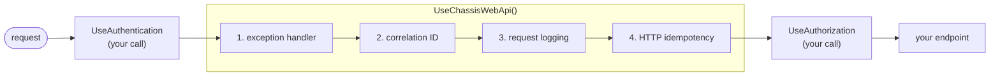
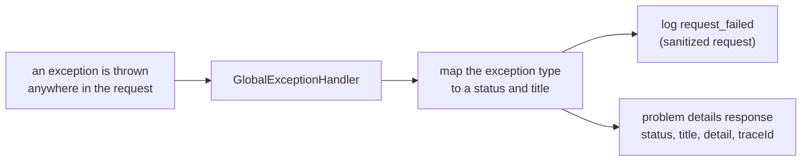
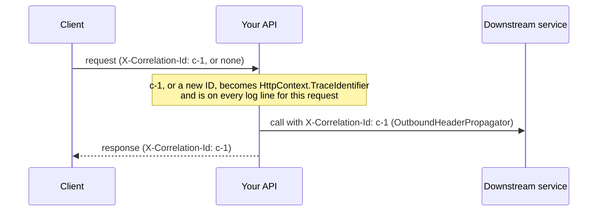
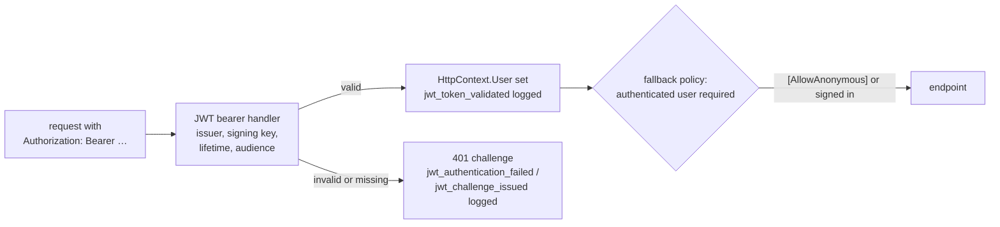
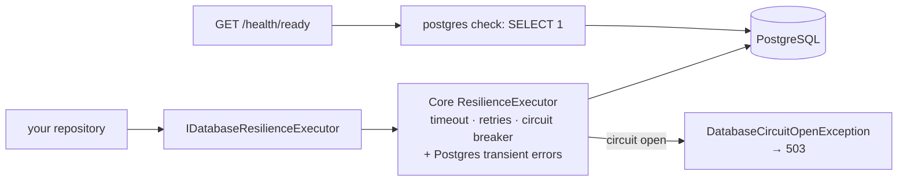
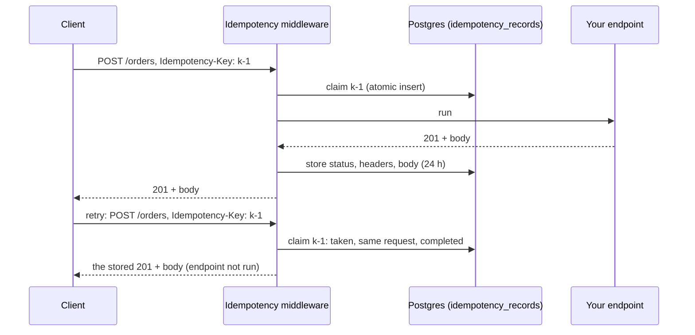

# QLS.Chassis.WebApi

The ASP.NET Core layer of the chassis: everything a JSON web API needs around its controllers, wired up with a few
lines in `Program.cs`.

| You get | How |
| --- | --- |
| Consistent error responses | A global exception handler that maps exceptions to status codes and returns RFC 7807 problem details |
| A correlation ID on every request | Middleware that reads or creates `X-Correlation-Id` and returns it |
| Structured request logs | One JSON log event per request, with secrets redacted from failed requests |
| JWT authentication | Bearer tokens from any OpenID Connect issuer (with shortcuts for AWS Cognito), and authentication required by default |
| The current user | `ICurrentUserAccessor` and `IUserContextService` read the user's ID, name, email and phone from the token |
| Resilient Postgres access | Timeouts, retries and a circuit breaker around database calls, plus a readiness health check |
| Idempotent endpoints | Put `[HttpIdempotent]` on an action and a repeated request gets the stored response, backed by Postgres |
| Health endpoints | `/health/live` and `/health/ready` |
| Swagger with JWT | A Bearer security scheme on the endpoints that need it |

It builds on [QLS.Chassis.Core](core.md) (configuration, resilience, idempotency, structured logging). Setup, the
samples and the repository layout are in the [README](../README.md).

## Contents

- [Requirements](#requirements)
- [Quick start](#quick-start)
- [Configuration](#configuration)
- [Components](#components)
  - [The request pipeline](#the-request-pipeline)
  - [Error handling](#error-handling)
  - [Correlation IDs](#correlation-ids)
  - [Request logging and observability](#request-logging-and-observability)
  - [JWT authentication](#jwt-authentication)
  - [The current user](#the-current-user)
  - [Postgres resilience](#postgres-resilience)
  - [HTTP idempotency](#http-idempotency)
  - [Health endpoints](#health-endpoints)
  - [Swagger](#swagger)
- [Walkthroughs](#walkthroughs)
  - [1. A new API from scratch](#1-a-new-api-from-scratch)
  - [2. Make an endpoint idempotent](#2-make-an-endpoint-idempotent)
  - [3. Query Postgres through the resilience executor](#3-query-postgres-through-the-resilience-executor)
  - [4. Return a specific error](#4-return-a-specific-error)
  - [5. Log a business operation](#5-log-a-business-operation)

## Requirements

- [.NET 8 SDK](https://dotnet.microsoft.com/download/dotnet/8.0)
- PostgreSQL, if you use the database resilience or idempotency components (the walkthrough runs one in Docker)
- A JWT issuer, if you use authentication: AWS Cognito, Auth0, Entra ID, Keycloak or any OpenID Connect provider

## Quick start

`Program.cs` for an API with everything turned on:

```csharp
using QLS.Chassis.WebApi.Data;
using QLS.Chassis.WebApi.Extensions;
using QLS.Chassis.WebApi.Idempotency;

var builder = WebApplication.CreateBuilder(args);

builder.Services.AddControllers();
builder.Services.AddEndpointsApiExplorer();
builder.Services.AddSwaggerGen(options => options.AddChassisJwtSecurity());

builder.Services.AddChassisWebApi();                                    // errors, logging, current user
builder.Services.AddChassisJwtAuthentication(builder.Configuration);    // reads the "Auth" section
builder.Services.AddChassisPostgresDatabaseResiliency(
    builder.Configuration, "AppDb", DatabaseResiliencePolicies.Default); // reads ConnectionStrings:AppDb
builder.Services.AddChassisHttpIdempotency(
    HttpIdempotencyPolicies.Default, HttpIdempotencyCleanupPolicies.Default);

var app = builder.Build();

if (app.Environment.IsDevelopment())
{
    app.UseSwagger();
    app.UseSwaggerUI();
}

app.UseAuthentication();   // before the chassis, so logs and idempotency keys know the user
app.UseChassisWebApi();    // exception handler, correlation ID, request logging, idempotency
app.UseAuthorization();

app.MapControllers();
app.MapChassisHealthEndpoints();

app.Run();
```

Only `AddChassisWebApi()` and `UseChassisWebApi()` are required; the rest are independent. Two dependencies to know
about:

- `AddChassisHttpIdempotency` needs `AddChassisPostgresDatabaseResiliency` (it stores records in Postgres) and
  `AddChassisWebApi` (it logs through the chassis logger).
- `AddChassisJwtAuthentication` needs `AddChassisWebApi` (its token events are logged through the chassis logger).

## Configuration

`appsettings.json`:

```json
{
  "ConnectionStrings": {
    "AppDb": "Host=localhost;Port=5432;Database=app;Username=app"
  },
  "Auth": {
    "Authority": "https://login.example.com/",
    "Audience": "my-api",
    "RequireHttpsMetadata": true,
    "ClockSkewMinutes": 2
  }
}
```

Keep credentials out of the file: in production, set the connection string through an environment variable
(`ConnectionStrings__AppDb`), a secrets manager, or [user secrets](https://learn.microsoft.com/aspnet/core/security/app-secrets)
in development.

| Setting | Required | Meaning |
| --- | --- | --- |
| `ConnectionStrings:<name>` | with database resilience | the Postgres connection string; start-up fails with `Missing ConnectionStrings:<name>` when absent |
| `Auth:Authority` | with JWT auth | the token issuer's URL, or a Cognito user pool ARN |
| `Auth:Audience` | outside Development | the audience (`aud`) tokens must have; checked only when set, and required in every environment except Development |
| `Auth:RequireHttpsMetadata` | no (default `true`) | set `false` only for a local issuer over plain HTTP |
| `Auth:ClockSkewMinutes` | no (default 2) | tolerance for token expiry, 0 to 10 |

`AddChassisJwtAuthentication(configuration, sectionName)` takes a different section name if `Auth` is taken.

## Components

### The request pipeline

> **See it run:** [../samples/QLS.Chassis.WebApi.Sample/Program.cs](../samples/QLS.Chassis.WebApi.Sample/Program.cs).

`UseChassisWebApi()` adds four middlewares, in this order:



1. **Exception handler** (`GlobalExceptionHandler`): outermost, so an exception anywhere after it becomes a problem
   details response and is logged once.
2. **Correlation ID**: before logging, so every log line has it.
3. **Request logging**: reads the request body once (for error logs and idempotency) and logs the result.
4. **HTTP idempotency**: closest to the endpoint, so a replayed response skips only your code.

Call `UseAuthentication()` **before** `UseChassisWebApi()`. Idempotency records are scoped per user, and request logs
include the user ID; both read the authenticated user, which only exists once authentication has run. (Without it,
every caller's idempotency keys share one "anonymous" scope.) Call `UseAuthorization()` after.

### Error handling

> **See it run:** [../samples/QLS.Chassis.WebApi.Sample/Orders/OrderEndpoints.cs](../samples/QLS.Chassis.WebApi.Sample/Orders/OrderEndpoints.cs): `POST /orders` with quantity 0
> throws `ApiException` (400), and `GET /orders/{id}` for a missing order throws `KeyNotFoundException` (404).



`AddChassisWebApi()` registers `GlobalExceptionHandler`, which turns exceptions into
[problem details](https://www.rfc-editor.org/rfc/rfc7807) responses:

| Exception | Status | Title |
| --- | --- | --- |
| `ApiException` | its `StatusCode` | its `Title` |
| `UnauthorizedAccessException`, `UserContextUnavailableException` | 401 | Unauthorized |
| `ValidationException` (DataAnnotations) | 400 | Validation error |
| `IdempotencyKeyRequiredException` | 400 | Idempotency key required |
| `IdempotencyKeyReuseConflictException` | 409 | Idempotency key conflict |
| `IdempotencyRequestInProgressException` | 409 | Idempotency request in progress |
| `KeyNotFoundException` | 404 | Resource not found |
| `DatabaseCircuitOpenException` | 503 | Service unavailable |
| anything else | 500 | Unexpected error |

```json
{
  "title": "Idempotency key conflict",
  "status": 409,
  "detail": "Idempotency key has already been used with a different request payload.",
  "instance": "/orders",
  "traceId": "8e0f4c1b2a9d4e7f9a3b5c6d7e8f9a0b"
}
```

`traceId` is the request's correlation ID, so a client can quote it and you can find the logs.

> **What clients see:** `detail` is the exception's `Message`, for every status including 500. Throw exceptions whose
> messages are safe to show, or replace `GlobalExceptionHandler` with your own `IExceptionHandler` if your code (or a
> library) may put internal details in exception messages.

Every handled exception is also logged as a `request_failed` event with the sanitized request (see below).

### Correlation IDs

> **See it run:** send `X-Correlation-Id: demo-123` to any endpoint of the [web API sample](../README.md#run-the-samples)
> and it comes back on the response and in the log line.



`CorrelationIdMiddleware` reads `X-Correlation-Id` from the request, or creates one (a GUID) when it's missing. It
then:

- sets `HttpContext.TraceIdentifier` to it, which is what the chassis logs and error responses use;
- returns it in the `X-Correlation-Id` response header;
- opens an `ILogger` scope with `CorrelationId`, so your own `ILogger` calls in the request carry it too, if your
  logging provider includes scopes.

Pass the header along when you call other services (Core's `OutboundHeaderPropagator` does this) and one ID
follows the work everywhere. `HttpCorrelationIdAccessor` exposes the current ID to Core's resilience executor.

### Request logging and observability

> **See it run:** every request to the [web API sample](../README.md#run-the-samples) writes a `request_succeeded` or `request_failed` line to the console.

All chassis logs are written through `ILogger` as one JSON object per line: Core's `StructuredLogEvent`. The
service name is your application's name (`IHostEnvironment.ApplicationName`).

- **`RequestLoggingMiddleware`** logs `request_succeeded` after each request that completes, with method, path,
  status code, user ID and correlation ID. For requests that can have a body (not `GET`, `HEAD`, `DELETE`, `TRACE`,
  `OPTIONS`) it reads the body first and keeps it for error logs and idempotency.
- **`WebApiRequestLogger.LogError`**, called by the exception handler, logs `request_failed` with the exception and
  the request's headers, query string and body, passed through Core's `DefaultLogSanitizer` first:
  authorization headers, cookies, tokens, passwords, API keys and similar fields are replaced with `[REDACTED]`, and
  long values are truncated.
- **`IStructuredAppLogger`** is for your own code: `LogOperationSucceeded`, `LogOperationFailed` and
  `LogOperationWarning` write `operation_*` events with the current request's correlation ID, trace ID and user ID
  filled in. See [walkthrough 5](#5-log-a-business-operation).

### JWT authentication

> **No sample:** this needs a real token issuer. The [quick start](#quick-start) and [configuration](#configuration)
> show the setup.



`AddChassisJwtAuthentication(configuration)`:

- binds the `Auth` section to `ChassisJwtOptions` and **validates it at start-up**: a missing or invalid
  `Authority`, a `ClockSkewMinutes` outside 0–10, or a missing `Audience` outside Development stops the app from
  starting, instead of failing on the first request;
- configures JWT bearer authentication to check the issuer, signing key, lifetime (expiry required) and, when set,
  the audience;
- **requires an authenticated user on every endpoint** by default (a fallback authorization policy). Mark public
  endpoints with `[AllowAnonymous]`; the health endpoints already are;
- logs token events through `IStructuredAppLogger`: `jwt_token_validated` (with the subject), `jwt_challenge_issued`
  and `jwt_authentication_failed` (as a warning, with the exception).

**Cognito shortcut:** `Authority` can be a Cognito user pool ARN, for example
`arn:aws:cognito-idp:us-east-1:123456789012:userpool/us-east-1_Example`. It is turned into the issuer URL
`https://cognito-idp.us-east-1.amazonaws.com/us-east-1_Example`. Any other value is used as the issuer URL as it is.

### The current user

Two services read the signed-in user from the token's claims. Both are scoped to the request.

| `ICurrentUserAccessor` | `IUserContextService` | Claims read, first found wins |
| --- | --- | --- |
| `IsAuthenticated` | — | |
| `Subject` (string) | `GetUserId()` (`Guid?`), `GetRequiredUserId()` (`Guid`) | `sub`, name identifier, then `cognito:username` and `username` (`Subject` checks `cognito:username` first, the user ID methods `username` first) |
| `Email` | `GetEmail()` | `email` |
| `FirstName` | `GetFirstName()` | `given_name` |
| `LastName` | `GetLastName()` | `family_name` |
| `Phone` | `GetPhone()` | `phone_number`, mobile phone, home phone |

Use `ICurrentUserAccessor` when the subject is any string. Use `IUserContextService` when your user IDs are GUIDs (as
Cognito's `sub` is): `GetRequiredUserId()` throws `UserContextUnavailableException` when there is no user or the ID
isn't a GUID, which the exception handler returns as 401.

```csharp
public sealed class ProfileController(ICurrentUserAccessor currentUser) : ControllerBase
{
    [HttpGet("me")]
    public IActionResult Me() => Ok(new { currentUser.Subject, currentUser.Email, currentUser.FirstName });
}
```

### Postgres resilience

> **See it run:** [../samples/QLS.Chassis.WebApi.Sample/Orders/OrderStores.cs](../samples/QLS.Chassis.WebApi.Sample/Orders/OrderStores.cs) (`PostgresOrderStore`), with the sample's
> `postgres` profile. Stop the database while it runs: the first few requests fail with 500 after their retries,
> then the circuit opens and requests fail with 503 in a few milliseconds, without touching the database.



`AddChassisPostgresDatabaseResiliency(configuration, connectionStringName, policy)` registers:

| Service | What it is |
| --- | --- |
| `ChassisDatabaseOptions` | the connection string, read from `ConnectionStrings:<name>` |
| `IDatabaseResilienceExecutor` | runs database calls through Core's `ResilienceExecutor` |
| `ResilienceOptions` | the policy you passed, with Postgres-specific transient errors added |
| `ICorrelationIdAccessor` | `HttpCorrelationIdAccessor`, so resilience logs carry the request's correlation ID |
| a `postgres` health check | `SELECT 1`, tagged `ready` |

**What it does to each call:** a per-attempt timeout, retries for transient failures with exponential backoff, and a
circuit breaker that stops calling the database for a while once too many calls fail (details in Core's
[Resilience](core.md#resilience) section). Transient for Postgres means a
`TimeoutException`, an `NpgsqlException` whose `IsTransient` is true, or a `SocketException`, including when wrapped
in another exception.

`DatabaseResiliencePolicies.Default` is Core's default policy for a dependency named `postgres`: 2.5-second
timeout, 2 retries starting at 200 ms, and a circuit that opens at a 50% failure rate over at least 10 calls, for 30
seconds. To change it, pass your own:

```csharp
builder.Services.AddChassisPostgresDatabaseResiliency(builder.Configuration, "AppDb", new ResilienceOptions
{
    DependencyName = "postgres",
    TimeoutMs = 5000,
    MaxRetries = 3,
});
```

When the circuit is open, `IDatabaseResilienceExecutor` throws `DatabaseCircuitOpenException` (with `RetryAfterUtc`),
which the exception handler returns as 503: the API fails fast instead of piling up requests on a database that is
down. A call that times out or keeps failing after its retries throws Core's `ResilienceExecutionException`, which
the exception handler returns as 500.

See [walkthrough 3](#3-query-postgres-through-the-resilience-executor) for a repository that uses it.

### HTTP idempotency

> **See it run:** `POST /orders` in [../samples/QLS.Chassis.WebApi.Sample/Orders/OrderEndpoints.cs](../samples/QLS.Chassis.WebApi.Sample/Orders/OrderEndpoints.cs), with the sample's
> `postgres` profile ([docker-compose.yml](../samples/QLS.Chassis.WebApi.Sample/docker-compose.yml) and [db/init.sql](../samples/QLS.Chassis.WebApi.Sample/db/init.sql) create the
> table). The [README](../README.md#run-the-samples) has the requests to try.



Idempotency lets a client safely retry a request that changes something (for example after a timeout) without doing
it twice. The client sends an `Idempotency-Key` header with a unique value per logical operation; the first request
runs, and a repeat with the same key gets the stored response.

**Turning it on:**

1. Register it (after the database):

   ```csharp
   builder.Services.AddChassisHttpIdempotency(HttpIdempotencyPolicies.Default, HttpIdempotencyCleanupPolicies.Default);
   ```

2. Create the table. The store expects this shape (the default is `public.idempotency_records`):

   ```sql
   CREATE TABLE IF NOT EXISTS public.idempotency_records (
       idempotency_record_key text        PRIMARY KEY,
       status                 text        NOT NULL,
       fingerprint            text        NOT NULL,
       response_json          text        NULL,
       expires_at_utc         timestamptz NOT NULL,
       created_utc            timestamptz NOT NULL DEFAULT NOW(),
       updated_utc            timestamptz NOT NULL DEFAULT NOW()
   );

   CREATE INDEX IF NOT EXISTS ix_idempotency_records_expires_at_utc
       ON public.idempotency_records (expires_at_utc);
   ```

3. Mark the endpoints:

   ```csharp
   [HttpPost]
   [HttpIdempotent]
   public async Task<IActionResult> Create(CreateOrderRequest request, CancellationToken ct) { … }
   ```

   For minimal APIs: `app.MapPost("/orders", …).WithMetadata(new HttpIdempotentAttribute());`

Only endpoints with `[HttpIdempotent]` are affected. If an endpoint has it but idempotency isn't registered, the
request fails with a message telling you to call `AddChassisHttpIdempotency()`.

**What happens to a request** (the logic is Core's `HttpIdempotencyCoordinator`; this repository adds the
middleware and the Postgres store):

| Request | Result |
| --- | --- |
| `GET` or another method the policy doesn't cover | runs normally (the default policy covers `POST`, `PUT`, `PATCH`, `DELETE`) |
| no `Idempotency-Key`, or one over 128 characters | 400 Idempotency key required |
| first request with a key | runs; a response below 500 is stored for 24 hours with its status, headers and body |
| repeat with the same key and the same request | the stored response is returned; your endpoint doesn't run |
| same key, different request (body, query, path or method) | 409 Idempotency key conflict |
| same key while the first is still running | 409 Idempotency request in progress |
| first request failed with 5xx or threw | nothing is stored, so a retry with the same key runs again |

Keys are scoped to the signed-in user and the endpoint's route, so two users (or two endpoints) can use the same key
without clashing.

**Cleanup:** `HttpIdempotencyCleanupHostedService` deletes expired records in the background, every 15 minutes in
batches of 500 by default (`HttpIdempotencyCleanupPolicies.Default`). Pass your own `HttpIdempotencyCleanupPolicy` to
change that.

**A different schema or table:** pass an `HttpIdempotencyStorePolicy`. Names must be plain identifiers (letters,
digits and underscores, not starting with a digit), and are checked at start-up:

```csharp
builder.Services.AddChassisHttpIdempotency(
    HttpIdempotencyPolicies.Default,
    HttpIdempotencyCleanupPolicies.Default,
    new HttpIdempotencyStorePolicy { SchemaName = "orders_app", TableName = "idempotency_records" });
```

To change the header name, covered methods, record lifetime or which responses are stored, implement Core's
`IHttpIdempotencyPolicy` and pass it instead of `HttpIdempotencyPolicies.Default`.

The middleware buffers the endpoint's response in memory to store it, so keep it for ordinary JSON responses, not
large downloads or streams.

### Health endpoints

> **See it run:** `curl http://localhost:5080/health/ready` against the [web API sample](../README.md#run-the-samples); with the `postgres` profile it includes the database check.

`app.MapChassisHealthEndpoints()` maps two anonymous endpoints:

| Endpoint | Checks | Use it for |
| --- | --- | --- |
| `/health/live` | none: healthy whenever the process answers | liveness probes (restart the container if this fails) |
| `/health/ready` | every health check tagged `ready`, such as the `postgres` check | readiness probes (stop sending traffic if this fails) |

Add your own readiness checks with the tag:

```csharp
builder.Services.AddHealthChecks().AddCheck<QueueHealthCheck>("queue", tags: ["ready"]);
```

### Swagger

> **See it run:** open `http://localhost:5080/swagger` while the [web API sample](../README.md#run-the-samples) runs.

`options.AddChassisJwtSecurity()` on `AddSwaggerGen` adds a Bearer security scheme (paste the token without the
`Bearer ` prefix) and marks operations on controllers or actions with `[Authorize]` as needing it, with 401 and 403
responses. Operations with `[AllowAnonymous]` are left open.

Swagger only shows the lock on operations with an explicit `[Authorize]`. Endpoints without it still require
authentication, because of the fallback policy, so put `[Authorize]` on your controllers to keep the documentation
accurate.

## Walkthroughs

### 1. A new API from scratch

1. Get the chassis next to your new API and create the API:

   ```bash
   mkdir src && cd src
   git clone https://github.com/jmcfadden27/dotnet-service-chassis.git
   dotnet new webapi -n OrdersApi --use-controllers -o orders-api/OrdersApi
   ```

2. Reference the chassis from `orders-api/OrdersApi/OrdersApi.csproj` (WebApi brings Core with it):

   ```xml
   <ItemGroup>
     <ProjectReference Include="../../dotnet-service-chassis/src/QLS.Chassis.WebApi/QLS.Chassis.WebApi.csproj" />
   </ItemGroup>
   ```

   The chassis uses Swashbuckle.AspNetCore 6.6.2. If the template added an older version, raise it, or the build
   stops with a package downgrade error (NU1605):

   ```bash
   dotnet add orders-api/OrdersApi package Swashbuckle.AspNetCore --version 6.6.2
   ```

3. Start a local Postgres (trust authentication, for local development only), save the SQL from
   [HTTP idempotency](#http-idempotency) as `idempotency_records.sql`, and create the table:

   ```bash
   docker run -d --name orders-db -p 5432:5432 \
     -e POSTGRES_USER=app -e POSTGRES_DB=app -e POSTGRES_HOST_AUTH_METHOD=trust postgres:16

   docker exec -i orders-db psql -U app -d app < idempotency_records.sql
   ```

4. Replace `Program.cs` with the [quick start](#quick-start), and put the [configuration](#configuration) in
   `appsettings.Development.json`, with your issuer's `Authority` and `Audience`.

5. Run it and check it:

   ```bash
   dotnet run --project orders-api/OrdersApi
   curl -i http://localhost:5000/health/ready     # 200 Healthy; the X-Correlation-Id header is set
   curl -i http://localhost:5000/weatherforecast  # 401: the template's endpoint now requires a token
   ```

   (Use the port `dotnet run` prints.)

### 2. Make an endpoint idempotent

> Runnable version: [../samples/QLS.Chassis.WebApi.Sample/Orders/OrderEndpoints.cs](../samples/QLS.Chassis.WebApi.Sample/Orders/OrderEndpoints.cs) (minimal API), with the sample's `postgres` profile.

```csharp
[ApiController]
[Authorize]
[Route("orders")]
public sealed class OrdersController(IOrderService orders, IUserContextService user) : ControllerBase
{
    [HttpPost]
    [HttpIdempotent]
    public async Task<IActionResult> Create(CreateOrderRequest request, CancellationToken ct)
    {
        var order = await orders.CreateAsync(user.GetRequiredUserId(), request, ct);
        return Created($"/orders/{order.Id}", order);
    }
}
```

A client calling it:

```bash
KEY=$(uuidgen)

# First call: runs and creates the order → 201
curl -i -X POST http://localhost:5000/orders \
  -H "Authorization: Bearer $TOKEN" -H "Content-Type: application/json" \
  -H "Idempotency-Key: $KEY" -d '{"sku":"ABC-1","quantity":2}'

# Same call again (say the client timed out and retried): the same 201 and body; no second order
curl -i -X POST http://localhost:5000/orders \
  -H "Authorization: Bearer $TOKEN" -H "Content-Type: application/json" \
  -H "Idempotency-Key: $KEY" -d '{"sku":"ABC-1","quantity":2}'

# Same key, different body: 409 Idempotency key conflict
curl -i -X POST http://localhost:5000/orders \
  -H "Authorization: Bearer $TOKEN" -H "Content-Type: application/json" \
  -H "Idempotency-Key: $KEY" -d '{"sku":"ABC-1","quantity":3}'
```

Clients should create one key per logical operation (for example when the user presses "Place order") and reuse it
for every retry of that operation.

### 3. Query Postgres through the resilience executor

> Runnable version: [../samples/QLS.Chassis.WebApi.Sample/Orders/OrderStores.cs](../samples/QLS.Chassis.WebApi.Sample/Orders/OrderStores.cs).

```csharp
using Dapper;
using Npgsql;
using QLS.Chassis.WebApi.Data;

public sealed class OrderRepository(ChassisDatabaseOptions database, IDatabaseResilienceExecutor resilience)
{
    public Task<Order?> GetAsync(Guid id, CancellationToken ct) =>
        resilience.ExecuteAsync(async attemptToken =>
        {
            await using var connection = new NpgsqlConnection(database.ConnectionString);
            return await connection.QuerySingleOrDefaultAsync<Order>(new CommandDefinition(
                "SELECT id, sku, quantity FROM orders WHERE id = @Id",
                new { Id = id },
                cancellationToken: attemptToken));
        }, ct);
}
```

Open the connection inside the operation, so each retry gets a fresh one, and pass the attempt's token to the query,
so the per-attempt timeout cancels it. Retried operations should be safe to repeat: reads are; for writes, use a
transaction, or a natural key that makes a repeat a no-op.

### 4. Return a specific error

> Runnable version: [../samples/QLS.Chassis.WebApi.Sample/Orders/OrderEndpoints.cs](../samples/QLS.Chassis.WebApi.Sample/Orders/OrderEndpoints.cs).

Throw `ApiException` for errors that are part of your API's contract:

```csharp
if (order.ShippedUtc is not null)
    throw new ApiException(StatusCodes.Status409Conflict, "Order already shipped", $"Order {order.Id} has already shipped.");
```

The client gets a 409 problem details response with that title and detail, and the failure is logged with the
sanitized request. For a missing resource, `throw new KeyNotFoundException(…)` gives a 404.

### 5. Log a business operation

```csharp
public sealed class OrderService(IStructuredAppLogger log, OrderRepository orders)
{
    public async Task<Order> ShipAsync(Guid id, CancellationToken ct)
    {
        var started = Stopwatch.GetTimestamp();
        try
        {
            var order = await orders.ShipAsync(id, ct);
            log.LogOperationSucceeded("orders.ship", StatusCodes.Status200OK,
                durationMs: (long)Stopwatch.GetElapsedTime(started).TotalMilliseconds,
                operationMetadata: new Dictionary<string, string?> { ["orderId"] = id.ToString() });
            return order;
        }
        catch (Exception ex)
        {
            log.LogOperationFailed("orders.ship", ex, StatusCodes.Status500InternalServerError,
                operationMetadata: new Dictionary<string, string?> { ["orderId"] = id.ToString() });
            throw;
        }
    }
}
```

Each call writes one JSON event, with the request's correlation ID, trace ID and user ID filled in, so you can find
every operation a request performed.
